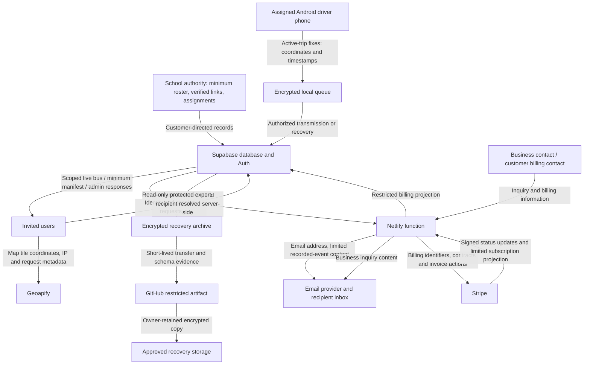

# SafeBus Privacy Impact Assessment — Business and CR1 Draft

**Status:** Draft prepared before customer onboarding; not approved or submitted
**Operator:** `[PROVIDER_LEGAL_NAME]`, Alberta-registered Canadian business
**Responsible business contact:** Business owner, selected Privacy Lead 2026-10-15 / `[PRIVACY_EMAIL]`
**Prepared:** 2026-10-13 (America/Edmonton)
**Scope reference:** CR1 product boundary and source based on merged PR 263

**2026-10-15 implementation addendum:** Role-specific notices are now prepared at
`/privacy#tenant-administrators`, `/privacy#guardians` and `/privacy#drivers`, with
account-menu and signed-out access. The owner remains Privacy Lead; identity and
direct contact are unresolved. The [current legal/privacy record](legal-privacy-completion-2026-10-15.md)
adds primary supplier/legal sources and bounded hosted evidence: retention is
disabled and eight dry-run branches fail with SQLSTATE 42702. No disposal,
supplier, customer PIA or final privacy approval is inferred from notice access.

## 1. Assessment purpose, ownership and evidence

This assessment describes the proposed SafeBus business/service, information
flows, risks and required safeguards. It can be drafted by the owner before
appointing counsel or obtaining a customer. It supports business privacy review
and a later school-authority assessment; it is not the customer's signed PIA,
a completed OIPC template, a submitted assessment or launch authorization.

The owner confirmed Alberta registration and requested business/contact
placeholders. No customer has been identified in this draft. Customer name,
public-body/delegation evidence, operational scope, purposes/authority and any
required public-body sign-off/submission are added during onboarding. This does
not transfer ownership of the app/business to the customer.

Evidence comes from the repository's CR1 scope, data/role drafts, Android native
tracking source, app privacy/account-deletion pages, billing/email code,
security remediation and protected recovery records. No fresh hosted database,
provider, physical-device or supplier-contract verification was performed to
prepare this document. Source code and synthetic tests are controls/evidence
inputs, not proof that a control is installed, legally sufficient or effective
in production.

Primary companion documents: [legal-role analysis](legal-role-analysis.md),
[data inventory/flow](data-inventory-and-flow.md),
[business privacy/commercial pack](business-pack/README.md),
[retention](retention-schedule.md), [suppliers](subprocessors.md),
[access/correction](access-and-correction.md), [breach](breach-response.md) and
[holds](legal-hold-procedure.md). Existing hosted findings are tracked in
[commercial security remediation](../../qa/commercial-security-remediation.md).

## 2. Project, individuals and boundaries

SafeBus provides school transport organization, fleet/route assignments, minimum
roster and guardian links, trip workflows, active-trip bus visibility, bus QR
start, student-only CSV import and enabled pickup/drop-off email. Administrators
use the website; guardians/drivers use the role-scoped Android/mobile entry point.
The first real-data pilot is limited to one to three Alberta public-school-authority
tenants and 25–100 buses, with separately authorized participants and support.

Affected people include selected students, guardians, drivers, school/transport
administrators and SafeBus's own business contacts/personnel. Minors' identity,
relationships and driver/bus location are sensitive even though the tracked unit
is the bus. Linking a roster and trip can reveal information about people.

CR1 excludes child GPS/devices, student QR boarding, traffic-aware ETA, guardian
trip-history replay, SIS integration, SMS and iOS. Android FCM remains separately
gated off. Development code for excluded functions does not make them part of
this PIA's permitted operating scope. Before release, verify that excluded
surfaces/endpoints cannot be activated under the CR1 contract unintentionally.

SafeBus's own necessary inquiry, billing, support, security and employment
processing are assessed separately. There is no approved secondary use of
customer transport records for advertising, resale, unrelated profiling or
AI training. This assessment does not approve expansion to the planning target
of 10,000 buses or 100,000 concurrent users.

## 3. Role and authority assessment

| Activity                                            | Working role                                                                   | Authority/notice still required                                                                                                       |
| --------------------------------------------------- | ------------------------------------------------------------------------------ | ------------------------------------------------------------------------------------------------------------------------------------- |
| Customer roster, links, assignments and trips       | Service supplied on public authority's documented instructions                 | Customer public-body status; applicable POPA/education provisions; minimum fields and indirect/direct collection notice               |
| Driver phone active-trip location and recovery      | Customer-directed bus tracking with identifiable driver context                | Customer operational/employee/BYOD authority, direct notice/permission and applicable consent/exception analysis                      |
| Linked guardian visibility and recorded-event email | Customer-authorized recipient scope; optional channel choices where applicable | Verified link/authority, purpose, lawful disclosure and channel notice/choice                                                         |
| Business inquiries, contracts, billing and support  | SafeBus own-business processing where applicable                               | Necessary purpose, PIPA/PIPEDA application, consent/exception and supplier notices; assess business-contact exclusions where relevant |
| Security/audit, incident and request records        | Separate necessary accountability/supporting purposes                          | Justified fields, access, appropriate statutory ground, retention and customer/business allocation                                    |

A signed service contract, acceptance of terms, Android permission or a label
such as "contract performance" is not by itself a public body's legal authority.
For each actual field/activity identify the relevant provision and purpose before
collection. No legal authority is marked approved in this draft.

The OIPC distinguishes voluntary private-business PIPA PIAs from prescribed
public-body POPA preparation/submission. Hiring a lawyer is not identified as a
general appointment requirement by the reviewed guidance; accountable business
privacy ownership is still needed. DL-023 replaces the repository's former
unconditional counsel signature with a sourced legal-requirements assessment.
[OIPC PIA guidance](https://oipc.ab.ca/privacy-impact-assessments/),
[OIPC PIPA implementation guidance](https://oipc.ab.ca/resource/pipa-implementation/).

## 4. Information inventory and minimization

| Information group                                                                        | Source and necessity                                                                   | Authorized recipients / open limits                                                                     |
| ---------------------------------------------------------------------------------------- | -------------------------------------------------------------------------------------- | ------------------------------------------------------------------------------------------------------- |
| Account name/email, role, tenant/school, invitation/session data                         | Authority invitations and user sign-in; authentication and authorization               | Auth service and authorized account operators; secret values never in drafts/logs                       |
| Minimum student name, grade, school, assignments and guardian links                      | Authority roster/verified relationships; operate transport and select the assigned bus | Scoped admins and assigned manifest; guardian's own linked scope only                                   |
| Driver operational identity and assignments                                              | Customer operations; assigned bus/route/trip                                           | Authorized transport staff and assigned driver; no full driver identity disclosed through guardian map  |
| Bus/route/stop/shape/trip state                                                          | Customer transport operations and authorized actions                                   | Operational roles as scoped; no unrelated tenant/school access                                          |
| Location coordinates, collection timestamp, accuracy and movement metadata               | Authorized driver's phone during collecting trip; bus status/history                   | Authorized live visibility and staff scope; raw history not guardian replay                             |
| Operational pickup/drop-off and email delivery records                                   | Authorized manual event; enabled guardian channel                                      | Authorized recipient; email may include student first name, event and time, without coordinates         |
| Local Android installation/session state and offline payload                             | Secure device registration, authorized recovery                                        | Protected local storage and authorized ingestion; purge/revocation limits pending physical verification |
| Business contact/inquiry name, work email, organization/role, optional phone and message | Prospective-customer form; respond to an inquiry                                       | Business email recipients and email provider; user notice must exclude student/sensitive content        |
| Billing contact, PO, bus allowance, price/term/invoice status                            | Business contract and Stripe                                                           | Restricted platform/tenant billing roles; no card/bank details in app projection                        |
| Network/security/audit/diagnostic metadata                                               | Requests, abuse prevention, accountability and support                                 | Minimized role/supplier access; logs can identify people and require retention/country review           |
| Optional push/token/device metadata                                                      | Only if separately authorized in a later activation                                    | Not activated by CR1/draft; assess Google flow separately                                               |

This is a categorized inventory. The companion inventory records source fields
and outstanding validation. Final field-to-authority and elimination review is
still required against the installed schema and released binary. Do not describe
this draft as an exhaustive audited database catalog.

Reject prohibited government student identifiers, student home addresses, health
data, custody narratives and unrelated school records. Stops can still reveal
sensitive context; minimization is not limited to removing a home-address column.
Free-text inquiry/support/admin notes can collect unexpected information: limit
purpose and access, give clear warnings and handle/redact unsolicited sensitive
content under the approved procedure. Preserve evidence lawfully if needed.

## 5. Information-flow map

This identifies information moving between entities; it is not proof of where
all those entities process/store it. Website/CDN/function and Auth requests also
involve provider network metadata/logs. Customer/support correspondence and
recipient inbox copies are separate stores. A future monitoring/support/FCM
flow requires its own inventory and approval before activation.

## 6. Android collection and visibility

The native source currently requests three-second active-trip collection.
Android foreground-service disclosure and notification identify collection;
pausing/ending collection stops new location fixes. Earlier encrypted queue
entries can transmit later during permitted recovery, including after pause/end.
The source bounds configured offline authorization at 18 hours; that bound is
not evidence of guaranteed immediate offline revocation or the physical queue's
maximum retention. Confirm those separately with device tests.

Measure collection outside an authorized trip, screen lock/background, permission
withdrawal, crash/reboot, network loss, token/session revocation, delayed/future
or duplicate events, queue purge and lost-device effects. Old events must not
regress fresh position or re-expose ended-trip information. Signed-device
acceptance, rural/battery/data results and hosted ingestion remain open.

Guardians should not disclose their own GPS to see the assigned bus. The bus QR
camera path and any local frames/permissions must be checked against the released
binary; do not conflate synthetic camera tests with a data-handling audit.
The customer must separately settle driver BYOD, support, reimbursement and
employment/privacy duties.

## 7. Access, accuracy and rights

The proposed access model limits administrators by tenant/school/role, drivers by
assignment, guardians by current verified link and platform administration to
the narrow business control plane. It does not grant the app owner a general
right to browse customer transport records. S1–S5 hosted authorization/session
findings remain open even where prepared code or client tests exist.

The customer maintains roster accuracy, links and assignments and determines
student/independent-student authority. A linked app view is not a statutory
access-right determination. SafeBus routes customer requests promptly and handles
its own-business requests directly. Access uses ATIA for the public authority;
public-sector correction uses POPA; own-business requests apply the relevant
PIPA/PIPEDA rules. Verify statutory due dates and extensions per case, rather
than a universal draft deadline. App sign-in must not be mandatory for requests.

Use the access/correction procedure and scoped legal holds. Validate responsive
searches across database, email, supplier logs/billing and controlled support,
with redaction, records, decision explanations and the relevant complaint path.
No bulk guardian export or RLS bypass is justified by a request.

## 8. Retention, return and disposal

The proposed schedule includes 30-day raw GPS, 90-day specified terminal
notification/security lifecycle classes, 13-month specified transport/inactive
identity classes and 24-month audit minimization. Business inquiry/support,
contracts/tax, requests/incidents, supplier logs, local device data and backups
need separate purpose/period decisions. These are not statutory periods.

Destructive retention is not represented as activated. Verify safe holds,
dependencies/triggers, anonymization linkability, failure handling and approved
enforcement on the authorized target. Account/link removal, Auth revocation,
primary deletion, provider disposal and backup expiry are different outcomes.
Before a restore returns to service, reapply verified deletion/revocation.
Existing stored backup copies still need approved expiry, access and location
decisions. Restore exercises are excluded from launch acceptance under DL-023;
historical recovery evidence is preserved separately.

Contract exit proposes secure, authorized tenant-scoped return and scoped
completion evidence; its format/capability and 30/60-day proposed windows need
owner/customer approval and operator validation. Do not promise a general export
feature or instant remote wipe merely by including contract language.

## 9. Suppliers, residency and backups

The supplier register now includes Supabase, Netlify, email, Geoapify, Stripe,
GitHub recovery-artifact transfer, owner recovery storage, and separately gated
Google/optional tools. Verify legal entities, role, agreement, countries, access,
retention, downstream providers and security evidence for each flow.

A Canadian Supabase database does not establish Canadian CDN, function, email,
map, billing, log, support or artifact processing. IP addresses and map viewport
coordinates can reveal context. Encryption of a GitHub recovery artifact is a
safeguard, not automatic removal from privacy/residency assessment. No blanket
Canadian-only or no-at-rest-data representation is made here. Cross-border
commercial applicability, notices and any permitted exception remain decisions.

## 10. Risk register for this assessment

Initial ratings are engineering prioritization, not a legal harm determination.
Residual risk is not accepted while required evidence remains open.

| ID / initial priority | Risk                                                                      | Prepared/proposed control                                               | Closure evidence / owner                                                                                                                   |
| --------------------- | ------------------------------------------------------------------------- | ----------------------------------------------------------------------- | ------------------------------------------------------------------------------------------------------------------------------------------ |
| PIA-01 / High         | School admins read other schools' location; cross-tenant disclosure       | Scoped restrictive policies and exact authorization manifest            | Security: installed catalog plus real REST/RPC allow/deny tests, including NULL-school routes; open S1                                     |
| PIA-02 / High         | Guardian reads private notes or unrelated students                        | Explicit safe columns and scoped admin-notes RPC                        | Security: positive admin/negative guardian and inactive/expired-link tests; open S2                                                        |
| PIA-03 / High         | Revoked user retains JWT, refresh, realtime or native access              | Prepared Auth-session, mirror, hook and lifecycle hardening             | Security/device QA: recovery-gated installation and real signed-session, socket and Android tests; open S3/S4                              |
| PIA-04 / High         | Device/off-trip data or delayed recovery leaks location                   | Native encrypted queue, collection state and bounded authorization      | Device QA: physical lost/revoked/offline/ended-trip, purge, latency and disclosure tests                                                   |
| PIA-05 / High         | Deletion/backup/hold representations exceed actual behavior               | Draft scheduler, approved disposal procedure and scoped holds           | Privacy/operations: correct confirmed dry-run failures, accept periods, test disposal/holds and supplier windows; recovery drills excluded |
| PIA-06 / High         | Unexpected foreign provider/log/artifact processing                       | Supplier inventory, minimization, encryption and country review         | Privacy/vendor owner: actual countries/contracts/notices and approved decisions                                                            |
| PIA-07 / High         | Wrong-recipient email or optional feature activation                      | Authorized recipient checks, minimal content and activation gates       | Security/privacy: enabled-scope review, direct recipient/expiry tests and supplier acceptance                                              |
| PIA-08 / High         | Unverified guardian/student authority or overcollection in free text      | Customer verification and minimum fields/notices                        | Customer/privacy: onboarding authority, field review, free-text handling and independent-student procedure                                 |
| PIA-09 / High         | Business policy misses inquiries, payments or customer-independent rights | Separate business inventory, Stripe disclosure and direct request route | Business privacy lead: purpose/authority, finance/vendor and request exercise evidence                                                     |
| PIA-10 / High         | Contract promises unavailable capacity, uptime or recovery                | Unfilled targets and activation/acceptance conditions                   | Product/operations: paid plans/quotas, measured workload/device/monitoring/recovery and approved SLA                                       |
| PIA-11 / Medium       | Owner absence, weak incident/request routing or missed legal notice       | Named backup, breach/request/hold procedures                            | Privacy/operations: appointed resources, routing and tabletop incl. applicable POPA recipients                                             |
| PIA-12 / High         | Public/app/Play notices conflict with practices or excluded scope         | Reconciliation and publication gate                                     | Privacy/product: approved consistent texts, working contacts/URLs and store/privacy evidence                                               |

Assess impact/likelihood again after evidence and record actual remaining risks,
dispositions, accountable reviewer, deadlines and expiry outside public Git.
No critical/high finding is closed merely by drafting or by a local UI test.

## 11. Assessment of OIPC template topics

| Template area                                                          | Coverage here                       | Customer/deployment completion                                                                                                  |
| ---------------------------------------------------------------------- | ----------------------------------- | ------------------------------------------------------------------------------------------------------------------------------- |
| A–B: organization and project                                          | Sections 1–2                        | Exact public body, head/delegate, deployment/start, related PIAs and chosen participants                                        |
| C: privacy program                                                     | Business procedures                 | Customer PMP and responsibilities, appointments/training/evidence                                                               |
| D: information and authority                                           | Sections 3–5; inventory             | Actual provisions per field/purpose/source, notices and consent/indirect collection assessment                                  |
| E: rights, accuracy and disposal                                       | Sections 7–8                        | Statutory workflows, accepted periods/holds and tested delivery/deletion                                                        |
| F–G: protection and suppliers                                          | Sections 6, 9–10; Security Schedule | Installed/field controls, agreements/countries and acceptance evidence                                                          |
| H: risks                                                               | Section 10                          | Validated residual risk, approvals and unresolved actions                                                                       |
| Appendices: matching, integrated service, automated/innovative systems | Classification pending              | Assess actual relationship joins/rules/workflows against prescribed triggers; absence of AI alone does not decide applicability |
| Cover/sign-off/submission                                              | Not completed                       | Customer assessment of required preparation/submission and authorized head/delegate evidence                                    |

For any required public-body submission, adapt this material to the current
[OIPC POPA template/guide](https://oipc.ab.ca/resource/popa-pia-template-completion-guide/).
The public-body head or appropriately delegated person supplies required sign-off;
the business owner's signature is not that delegation. Use the official assessment
of submission requirements for the actual service. No OIPC acceptance is claimed.

## 12. Review and approval record

| Review                                                        | Status                                                                                                     |
| ------------------------------------------------------------- | ---------------------------------------------------------------------------------------------------------- |
| Owner review of business purposes, contacts and terms         | Pending                                                                                                    |
| Statutory/role and field authority review                     | Draft; sourced applicability/compliance review pending                                                     |
| Customer-specific public-body/collection/notice/PIA authority | Deferred until onboarding                                                                                  |
| Supplier/country, retention/holds and contract decisions      | Pending                                                                                                    |
| Installed security, signed-device and service evidence        | Security installation verified; runtime/device/service acceptance open; recovery drills excluded by DL-023 |
| Required internal/customer Point 6 approvals                  | Not recorded                                                                                               |
| PIA submission where required                                 | Not assessed for a named customer; not submitted                                                           |

Record version, reviewer role, date, evidence reference, findings and actual
approval decision in controlled records. Only non-secret references enter the
machine-readable readiness record after approval. Continue drafting without
inventing appointments or customer signatures. This PIA remains a review draft
and does not authorize production operation or a pilot.
